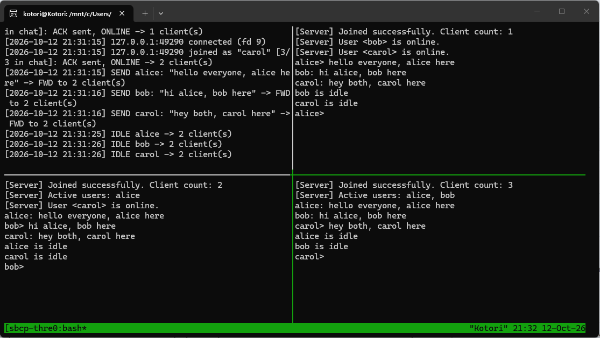
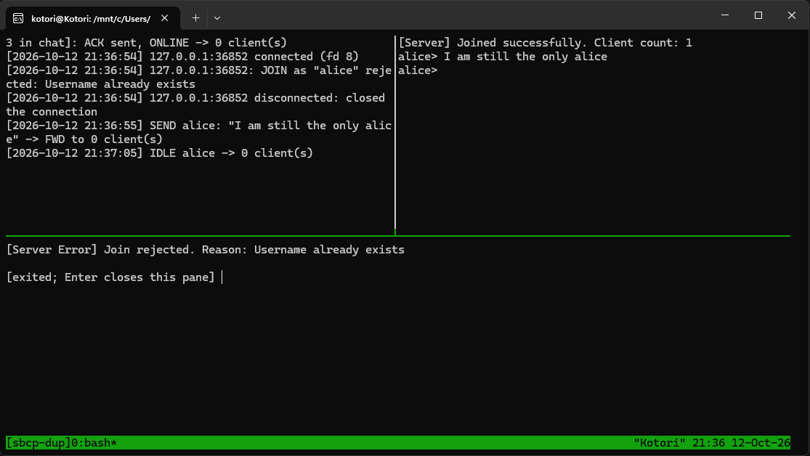
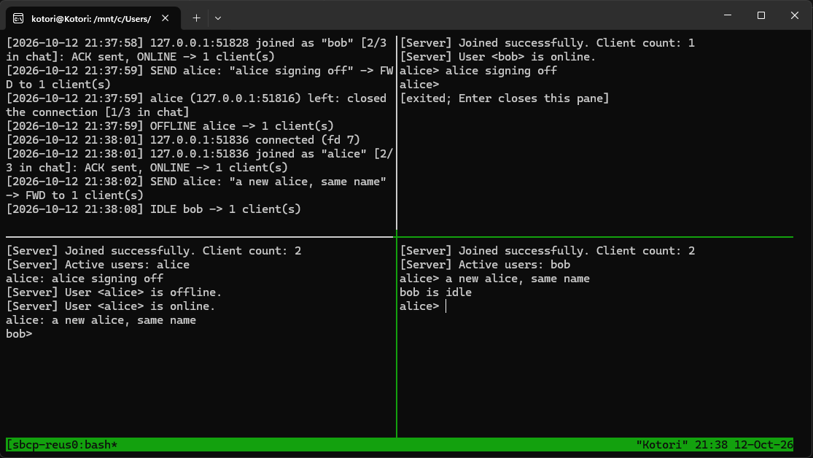
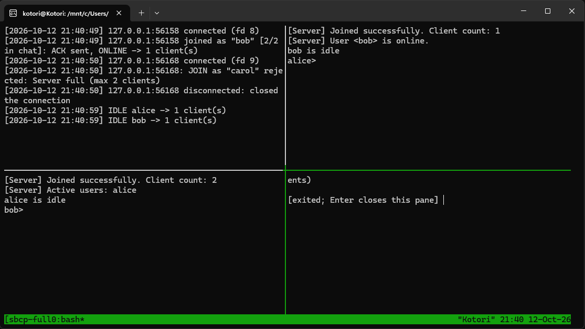
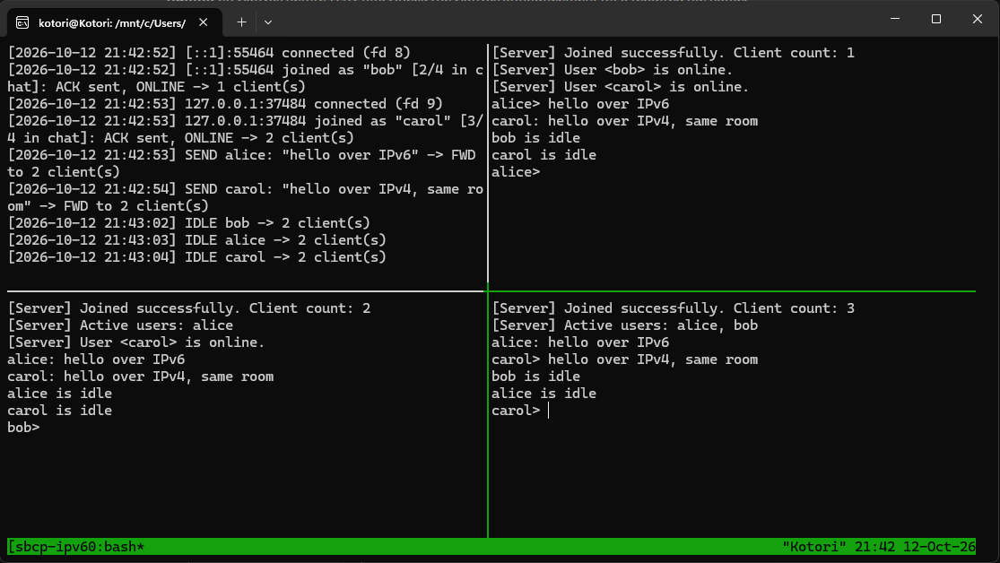
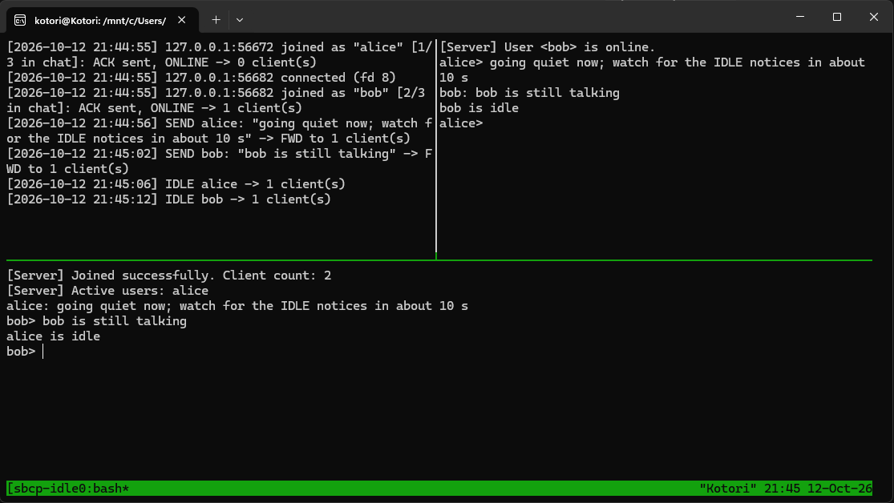

# ECEN 602 MP2 — Test Report

Team: Shih-Yu (Frank) Yang, Bozhou Chen (Kotori)
Test machine: WSL2 (Ubuntu) on Windows; kernel `_uname -r_`, `_gcc --version_`

## 1. How we tested

1. **Required cases by hand** (section 2): the server and each client in its
   own pane, one screen capture per case. `./tests/demo.sh <case>` opens the
   panes in tmux and types the messages. In every capture the top-left pane is
   the server log; the other panes are clients.
2. **Against the course's reference server** (section 3), with its log.
3. **Automated tests** (section 4): `make test`.

## 2. Required test cases

Server: `./server 127.0.0.1 9000 3` unless stated. Clients:
`./client <name> 127.0.0.1 9000`.

| # | Case | Steps | Expected |
|---|---|---|---|
| 1 | Normal operation, three clients (`demo.sh three`) | start alice, bob, carol; each types a line | each line appears at the other two as `alice: ...`; ACK counts 1, 2, 3 with the earlier members listed; earlier members see `<bob> is online` |
| 2 | Duplicate username rejected (`demo.sh dup`) | with alice in, start a second alice | it prints `Reason: Username already exists` and exits; the first alice is unaffected |
| 3 | Username reused (`demo.sh reuse`) | alice presses Ctrl-D, then a new alice starts | the others see `<alice> is offline`, then `<alice> is online`; the new alice gets an ACK |
| 4 | Room full (`demo.sh full`) | `./server 127.0.0.1 9000 2`, start three clients | the third prints `Reason: Server full (max 2 clients)` and exits |
| 5a | Bonus: IPv6 (`demo.sh ipv6`) | `./server :: 9000 4` (dual stack); alice and bob on `::1`, carol on `127.0.0.1` | chat works as in case 1, IPv4 and IPv6 clients in one room |
| 5b | Bonus: ACK, NAK, ONLINE, OFFLINE | cases 1–4 | count and member list on join, NAK reasons, online/offline notices |
| 5c | Bonus: IDLE (`demo.sh idle`) | alice sends a line and goes quiet; bob sends a line 6 s later | each client sends IDLE 10 s after its own last message; the other sees `<name> is idle` once |

### Case 1: normal operation, three clients



ACK counts 1, 2, 3, each with the earlier members (`alice`, then `alice, bob`).
alice and bob see carol come online. Each line reaches the other two, and the
server log shows `FWD to 2 client(s)` for each SEND. The IDLE notices at the
end come from the IDLE bonus, 10 s after each client's last message.

### Case 2: duplicate username rejected



The second alice prints `Join rejected. Reason: Username already exists` and
exits. The server log shows the rejection and the closed connection. The
first alice keeps chatting (`I am still the only alice`).

### Case 3: username reused



alice leaves with Ctrl-D; bob sees `<alice> is offline`. A new alice joins
under the same name: she gets an ACK (count 2, `Active users: bob`) and bob
sees `<alice> is online` and her message.

### Case 4: room full (max 2 clients)



alice and bob join (count 1 and 2). The server log shows
`JOIN as "carol" rejected: Server full (max 2 clients)`, and carol's pane
(bottom right) ends with that reason and exits. The other two are unaffected.

### Case 5a: bonus, IPv6



The server listens on `::` (IPv4 and IPv6). The log shows bob connecting from
`[::1]` and carol from `127.0.0.1`; both join the same room, and messages pass
between all three.

### Case 5b: bonus, ACK, NAK, ONLINE, OFFLINE

Shown in cases 1 to 4: ACK with the count and member list on every join, NAK
with its reason in cases 2 and 4, ONLINE in cases 1 and 3, OFFLINE in case 3.

### Case 5c: bonus, IDLE



alice sends at 21:44:56 and goes idle at 21:45:06; bob sends at 21:45:02 and
goes idle at 21:45:12, both exactly 10 s after their own last message. alice
received bob's message at 21:45:02 and still went idle at 21:45:06, so
received messages do not reset the clock. Each notice is shown once, to the
other client only.

## 3. Against the course's reference server

`ecewkgsw05201.engr.tamu.edu:9000`, on the campus network or VPN. Its log is
at `http://ecewkgsw05201.engr.tamu.edu:9002/`.

```sh
./client kotori_a ecewkgsw05201.engr.tamu.edu 9000 # terminal 1
./client kotori_b ecewkgsw05201.engr.tamu.edu 9000 # terminal 2
```

| Step | Expected in the clients | Expected in the server log |
|---|---|---|
| A joins, then B | A: `Client count: 1`; B: `Client count: 2`, `Active users: kotori_a`; A: `<kotori_b> is online` | `JOIN (version: 3, length: 12)`, `USERNAME (length: 8)`, `New user`, `Sent ACK`, `Sent ONLINE` |
| A types `hello` | B: `kotori_a: hello` | `SEND (… length: 9)`, then `FWD` to B |
| a second `kotori_a` | `Reason: Username already exists`, exits | `Username kotori_a already exists`, `NAK` |
| B silent for 10 s | A: `kotori_b is idle` | `IDLE (version: 3, length: 0)` from B, `IDLE` to A |
| Ctrl-D in B | A: `<kotori_b> is offline` | `Handler for kotori_b disconnected`, `OFFLINE` |

Run on Oct 12: join, ACK with count and name, ONLINE, chat in both
directions, IDLE, OFFLINE and the duplicate-name NAK all behaved as in the
table, and the server log showed the matching lines.

## 4. Automated tests

`make test` runs `tests/test_sbcp` (C). It starts the real `./server` and
`./client` and drives them over real sockets; `./tests/test_sbcp --list`
names every case.

- **Server, 44 cases**: raw connections send hand-built bytes. Exact bytes of
  every message, including the reference server's session from its log;
  messages split into single bytes or merged in one segment; garbage,
  unknown types, bad Length fields, messages that never finish; JOIN rules and
  NAK reasons; clients that reset before, during and after JOIN, also while
  the server is writing to them (the SIGPIPE case); a client that never reads;
  running out of descriptors; IPv6; Length fields that count the header.
- **Client, 38 cases**: the real client against the real server or a scripted
  server. ACK, NAK, FWD, ONLINE, OFFLINE and IDLE shown, also as the reference
  server sends them; an ACK with 120 names shown in full; malformed server
  messages discarded; exact JOIN, SEND and IDLE bytes; IDLE after 10 s while
  others keep talking; long, UTF-8 and piped input; messages arriving together
  or one byte at a time; terminal escape codes in received text shown as `^[`,
  and arrow-key codes not sent; IPv6; server shutdown and crash; bad
  arguments; on a real terminal: the prompt, a message arriving while a line
  is half typed, Ctrl-Z/fg, window resize, Ctrl-D after a half line.

| Machine | Result |
|---|---|
| WSL2 (Ubuntu) on Windows | `82 passed, 0 failed, 0 skipped in 116.1 s` |
